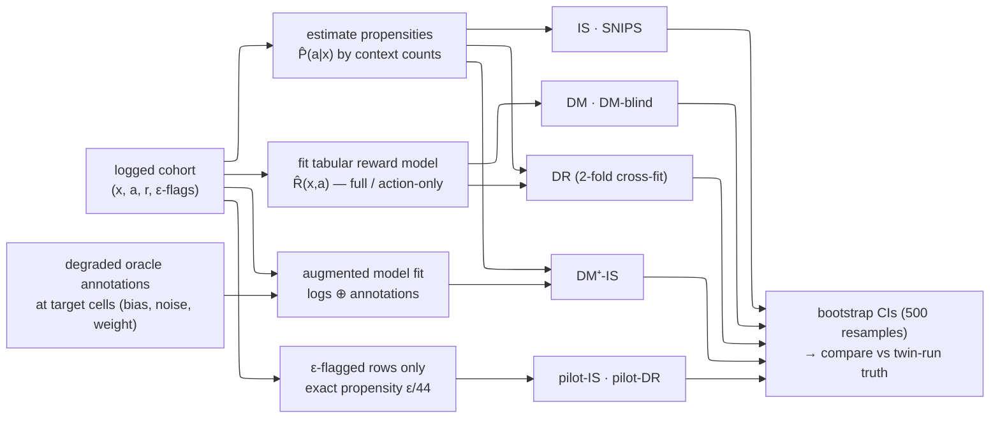

# The estimator panel, explained

A didactic companion to the paper's estimator table. All eight estimators
consume the same logged cohort; they differ in **what they trust**: a fitted
reward model, estimated propensities, exact design propensities, or a
combination. Implementations: `src/ope_bench/estimators.py`,
`src/ope_bench/annotator.py`, `src/ope_bench/panel.py`.

Notation: contexts $x$ (36 ids), actions $a$ (45 ids), logged reward $r_i$,
target policy $\pi_e$, estimated behavior propensities $\hat P(a \mid x)$
(empirical within-context frequencies), importance ratio
$\rho_i = \pi_e(a_i \mid x_i)\, /\, \hat P(a_i \mid x_i)$.

## The conditional-mean family (all logged rows, estimated propensities)

**DM (Direct Method, self-evaluated).** Fit a tabular reward model
$\hat R(x, a)$ on the logs, meaning one cell per (context, action) pair
whose value is the mean observed reward in that cell, then average the
model over the target policy's choices:

$$\hat V_{\mathrm{DM}} \;=\; \frac{1}{n} \sum_{i=1}^{n} \; \sum_{a} \pi_e(a \mid x_i)\, \hat R(x_i, a)$$

Trusts the model entirely. When the model is trained on the same logs it is
scoring (self-evaluation), errors of the model become errors of the estimate
and are invisible from inside the procedure.

**DM context-blind.** The same averaging with a coarser model, $\hat R(a)$,
fit on actions only. One cell per action, so the model ignores who receives
the action. A deliberately misspecified regime in which context-dependent
effects cannot be expressed at all.

**IS (importance sampling / Horvitz–Thompson).** No model at all. Each
logged reward is re-weighted by how much more (or less) often the target
policy would have taken the logged action than the behavior policy did:

$$\hat V_{\mathrm{IS}} \;=\; \frac{1}{n} \sum_{i=1}^{n} \rho_i\, r_i,
\qquad \rho_i = \frac{\pi_e(a_i \mid x_i)}{\hat P(a_i \mid x_i)}$$

Unbiased when the propensities are correct. Here they are *estimated* from
within-context action frequencies, so any selection those frequencies cannot
see (hidden confounding) enters $\rho_i$ and becomes bias.

**SNIPS (self-normalized IS).** IS with the weights renormalized:

$$\hat V_{\mathrm{SNIPS}} \;=\; \frac{\sum_i \rho_i\, r_i}{\sum_i \rho_i}$$

Trades a small bias for much lower variance and protection against
propensity overfitting.

**DR (doubly robust, cross-fitted).** Combines both trusts, so either one
may fail. The first term is the DM guess; the second is an IS-style
correction applied to the model's residual on the action actually taken:

$$\hat V_{\mathrm{DR}} \;=\; \frac{1}{n} \sum_{i=1}^{n} \Big[ \sum_{a} \pi_e(a \mid x_i)\, \hat R(x_i, a) \;+\; \rho_i \big( r_i - \hat R(x_i, a_i) \big) \Big]$$

Unbiased if *either* the model *or* the propensities are right. Cross-fitting
(2 folds: each row scored by a model not trained on it) prevents in-sample
leakage. Under hidden confounding both ingredients inherit the same logs, so
both legs fail together — the paper's frontier result.

**DM⁺-IS (annotation-augmented DR).** The DR formula unchanged, with a
better-fed reward model. The target policy needs values for
(context, action) cells the logs barely cover, so an annotator adds
synthetic training rows exactly there:

$$\hat R^{+} \;=\; \text{fit on } \underbrace{\{(x_i, a_i, r_i)\}}_{\text{logged rows}} \;\cup\; \underbrace{\{(x, a^{\pi_e}, \tilde r)\}}_{\text{annotations, weight } w}$$

The annotator is the oracle deliberately degraded with bias and noise, which
plays the role of the imperfect simulator a practitioner would have.
Annotations enter only the model fit, never the estimator sum — the variant
for which CANDOR proves annotator error becomes variance, not bias.

## The exploration-based family (ε-flagged rows only, exact propensities)

**pilot-IS.** At logging time, each explorable decision is randomized with
probability $\varepsilon$: the incumbent's action is replaced by a uniform
draw from the menu and the row is flagged. Flagged rows have exactly known
propensity $\varepsilon/44$ by design. Pilot-IS is Horvitz–Thompson
restricted to those rows:

$$\hat V_{\text{pilot-IS}} \;=\; \frac{1}{n_{\mathrm{anchor}}} \sum_{i \in \text{flagged}} \frac{\pi_e(a_i \mid x_i)}{\varepsilon/44}\; r_i$$

No model, no estimated propensities, no confounding path — but only about
1,300 rows per million-loan world, so intervals are roughly 3× wider.

**pilot-DR.** The DR construction on the same flagged rows, using a reward
model fit on the randomized subset and the exact-propensity correction.
Same identification guarantee as pilot-IS, slightly better variance.

## What separates them (one line each)

| estimator | trusts | fails when |
|---|---|---|
| DM | fitted model | model misspecified (silently) |
| DM-blind | action-only model | context matters at all |
| IS | estimated propensities | assignment reads hidden state |
| SNIPS | estimated propensities | same as IS (lower variance) |
| DR | either model or propensities | both fed by the same confounded logs |
| DM⁺-IS | DR + annotator coverage | confounded assignment (annotations can't fix) |
| pilot-IS | exact randomization | ε = 0 (does not exist); small n (wide CIs) |
| pilot-DR | exact randomization + model | same as pilot-IS |

## Implementation flow

